# 代码审计与模拟器走查

> 审计日期：2026-10-18。范围：Android `app/`、`domain/`、`data/` 三个模块，以及 Manifest、Gradle、CI、docs 状态。本文记录**代码级可确认**的缺陷、功能性缺口和验证证据；设备/模拟器走查结果追加在文末。

## 1. 结论

这是一个功能面较广、文档较完整、但运行验收明显落后于代码的原型。账本、SQLCipher、AES-GCM 备份、签名自更新、助手工具 allowlist 都有真实实现；当前主要风险不是“缺功能”，而是：

1. 特定 Android 版本或交互路径会**直接崩溃**；
2. 估值、提醒、报告会**静默给出错误数字**；
3. 某些能力“代码存在、测试存在、产品不可达”；
4. 迁移、备份、提醒、连续行情等关键路径缺少设备验收和自动化测试。

## 2. 验证基线

```bash
# JDK 21
./gradlew --offline :domain:test :data:testDebugUnitTest :app:testDebugUnitTest --rerun-tasks
# BUILD SUCCESSFUL
# domain 153 / data 33 / app 12 = 198 tests, 0 failures

./gradlew --offline :app:assembleDebug
# BUILD SUCCESSFUL，约 20 MB debug APK，versionCode 2 / 0.2.0

./gradlew --offline :app:lintDebug
# FAILED: 3 errors, 64 warnings
```

- 当前无连接设备/模拟器；`androidTest` 文件数为 0。
- 与账本、备份、SQLCipher 迁移、更新客户端直接相关的类没有单元测试。
- `README` 自述“SQLCipher 迁移、备份往返、连续行情、估值残差样本仍未完成设备验收”，与代码和测试证据一致。

`lint` 的 3 个 error：

| 位置 | 问题 |
|---|---|
| `app/.../AssistantScreen.kt:611` | `InputStream.readNBytes` 需要 API 33，但 `minSdk = 26` |
| `app/.../AlertNotifier.kt:47` | 通知权限检查被 lint 判定为 MissingPermission |
| `app/.../MarketDetailScreen.kt:239` | `AnimatedContent` 未使用 target state |

64 个 warning 中包括 30+ 处未指定 Locale 的 `String.format`、`allowBackup` 的 `DataExtractionRules`、`ObsoleteSdkInt` 等。

## 3. P0：崩溃与核心数字错误

### 3.1 Android 8–12 文本附件崩溃

`AssistantScreen.kt` 使用 `input.readNBytes(...)` 读取文本/CSV/JSON 附件。`readNBytes` 是 Android API 33 才提供的方法；项目 `minSdk = 26`，且没有开启 core library desugaring。`lint` 已报 `NewApi` error。

影响：在 Android 8/9/10/11/12 选择文本类附件会触发 `NoSuchMethodError` 并崩溃。

修复：手写 `read(buffer)` 循环并按 256 KB 上限截断；补 API 26 测试。

### 3.2 Android 12 及以下提醒通知被静默丢弃

`AlertNotifier.hasPermission` 在所有版本检查 `POST_NOTIFICATIONS`。该权限是 Android 13 才引入的；在 Android 12 及以下它通常不是系统已定义权限，`checkSelfPermission` 返回 `DENIED`，于是 `post()` 直接 return。`AlertScreen` 也会一直显示“尚未授予通知权限”。

影响：所有提醒规则在 Android 8–12 上都不会产生通知。

修复：按 `Build.VERSION.SDK_INT >= 33` 分支；低版本使用 `NotificationManagerCompat.areNotificationsEnabled()`。

### 3.3 板块成分股“加自选”崩溃

`MarketBoardScreens` 把成分股 `member.secid` 传给 `MainActivity` 的 `MarketDetailScreen`；点击“加自选”时调用 `ledger.setWatched(secid, watched)`。`Ledger.setWatched` 第一行 `require(MarketInstrumentCatalog.byId.containsKey(secid))`，而目录只有 25 个预设标的；绝大多数板块成分股不在其中，`require` 抛出 `IllegalArgumentException`，调用点没有捕获。

修复：允许任意合法 `secid` 加入自选并补名称/市场信息，或对不支持的标的隐藏“加自选”；调用点捕获异常显示提示。

### 3.4 账本不支持历史日期

`Ledger` 的所有事件写入都固定 `LocalDate.now(ZoneId.of("Asia/Shanghai"))`：

- `addTrade`
- `addCashDividend`
- `addDividendReinvestment`
- `addShareSplit`
- `addAssetTransfer`
- `addOpeningPosition`

`LedgerEntryScreen` 也没有交易日期输入。后果：

- 无法补录上月买入/卖出/分红；
- 无法导入历史流水并按原日期入账；
- 周报、月报、XIRR、最大回撤只能在“从今天开始记录”之后才有意义；
- 期初持仓只能解决当前份额和成本，不能补历史交易轨迹；
- 日期记错后没有 UI 更正路径。

这是首版闭环的产品级阻塞。建议所有 `add*` 增加 `day: LocalDate`、UI 日期选择器、按受影响区间重算快照，并校验日期不得晚于今天、不得早于现金跟踪起点。

### 3.5 基金估值前提可能不成立

#### 3.5.1 主指数路线没有基准净值年龄门槛

`FundNavEstimator.estimate` 的指数路线只要求存在一条早于行情日的净值，没有 `MAX_BASE_NAV_AGE_DAYS` 检查；对比债券/QDII 路线有该检查。暂停披露净值数月的基金，只要指数行情新鲜，仍会显示估算数字。

T1 的 `estimateDisclosedHoldingsSnapshot` 兜底也没有该年龄门槛。

#### 3.5.2 T1 主动基金回归存在前视/回填偏差

`estimateDisclosedHoldingsRegression` 取最新披露重仓股，把这些股票的复权日线回溯最近 60 个交易日构造历史组合收益，再用 20 天验证。如果季报披露日就在训练窗口内，前半段这些持仓可能还不存在；披露日较早时基金也可能已经调仓。代码只用 `holdingsReportDate` 做 180 天年龄检查，没有把训练窗口截断到披露日之后，也没有历史持仓快照。

结果：样本外 MAE/R² 偏乐观，不等于真实上线误差。

#### 3.5.3 QDII 按日历日平移

`shiftReturnsByLag` 用 `date.plusDays(1)`。周五海外收益被平移到周六，而基金净值只有周一；周末/长假后错位或丢失配对日。测试使用连续自然日合成数据，测不出该问题。

#### 3.5.4 移动端验收阈值低于项目自己的验收文档

- 代码：`VALIDATION_WINDOW = 20`，`MIN_VALIDATION_COUNT = 15`；T1 同样 20/15。
- `docs/13`：每个默认展示估值的基金类型至少 3 只代表基金、各不少于 120 个有效样本外交易日，并比较 P90、大波动日误差和方向命中。

当前实现是单基金、20 个验证点、MAE + 非中心化 R²，没有类型级 3 只样本、没有 P90、没有方向命中，UI 却按 20 天结果给出 HIGH/MEDIUM 等级。

#### 3.5.5 缓存历史可能过期但仍参与回归

`FundFeatureState.estimateNav` 在刷新指数日线失败时退回旧缓存；`FundNavEstimator` 只检查当前行情新鲜度，不检查训练用 `indexBars` 的年龄。

建议统一加：`baseNav` 年龄、训练数据年龄、当前行情日期是否等于今天；把 120 天/P90 验收做成离线报告，未达标不显示 HIGH。

### 3.6 最大回撤和时点加权贡献经常不可用

`PortfolioRiskAnalytics.maximumDrawdown` 要求：

- 期初快照正好是 `periodStart - 1 天`；
- 从期初到期末的每一个自然日都有快照。

任何周末、节假日、WorkManager 未执行、用户未打开 App 造成缺日，整个周/月最大回撤都显示不可用。

`ContributionAnalytics` 在 `app/` 和 `data/` 中零引用，没有屏幕、Agent 工具或报告调用；但 `docs/14` 已把 `REPORT-02`、`ATTR-01`、`ATTR-02` 标成 `[x]`。

修复：最大回撤改用 `TradingCalendar.expectedSessions` 和最近可用快照；贡献要么真正接入分析页/Agent，要么在文档中标记为“内核研究，未交付”。

### 3.7 提醒引擎核心观测错误

`AlertObservations`：

- 缺报价的持仓按 0 计入 `accountProfit`，亏损被低估；
- 只累加 `holdingProfit`，完全忽略 `realized`，卖出后收益、分红不进入“账户持仓收益率”；
- `QUOTE_STALE` 使用所有报价的 `max(fetchedAt)`，只要有一只标的刚刷新就永不触发；且用本机抓取时间而非源报价时间；
- `FUND_ESTIMATE_ABOVE` 永远返回 `value = null`，规则永远不触发；
- 提醒引擎不检查观测值时间，过期报价仍可能按旧价触发。

再叠加 Android 12 及以下通知被静默丢弃，提醒模块的实际可用性很低。

### 3.8 行情/快照写入 last-writer-wins，外部现金流不失效旧快照

- `addExternalCashMovement` 插入现金事件后没有调用 `invalidatePortfolioFactsFrom`；对比 `addTrade`、`addCashDividend`、`addShareSplit`、`addAssetTransfer` 都调用了。
- `savePortfolioSnapshot` 使用 `CONFLICT_REPLACE` 并固定写 `valid = 1`，不比较 `observed_at`；Worker 的旧捕获可能在冲正失效后把快照“复活”。
- `saveMarketQuotes` 无条件 `CONFLICT_REPLACE`，不比较 `quote_time`；首页刷新、自检、黄金页刷新并发时，较早响应晚到会覆盖较新报价。
- `addTrade` 的卖出校验在开启写事务前读取 `positions()`，插入后不再校验；并发卖出可能卖成负数。

修复：所有“读-校验-写”放进同一事务；快照/行情写入加时间戳 CAS；外部现金流补失效；卖出插入后重新计算。

## 4. P1：误导、边界与隐私

### 4.1 过期/缺失报价被当成完整估值

`Position.value` 只对 `MANUAL_BANK_BUYBACK` 判断有效期，普通市场报价没有年龄检查。`OverviewScreen` 用 `quoteCount = positions.count { it.quote != null }` 判断覆盖率；`MainActivity` 用 `sum + (p.value ?: BigDecimal.ZERO)` 计算总市值和持仓盈亏。

后果：

- 普通行情几天/几周没更新，首页仍按旧价显示“当前总资产”；
- 银行黄金报价过期后 `quote` 非空但 `value` 为 null，`quoteCount` 仍算“有报价”，主页不提示缺报价，但总市值按 0 计算；
- `holding` 与 `totalValue - totalCost` 可能对不上。

修复：覆盖率按 `value != null` 统计；任一持仓缺有效报价时总市值/盈亏返回 null 或显示“部分估值”；普通行情也加 72 小时/交易日新鲜度门槛。

### 4.2 助手执行层边界

- `AgentToolRegistry` 在 `errorCode != null` 时清空 facts，导致 `PortfolioChangeProposalAgentTool` 返回的 `proposal.error` 原因永远到不了模型；这与 README 的“校验原因回灌给模型”冲突。
- `PortfolioChangeProposalAgentTool.tradeProposal` 分别接收 `amount`、`units`、`unit_price`、`fee`，没有校验 `amount ≈ units * unit_price + fee`；模型可以提议金额/份额不一致的买入，用户确认后成本价失真。
- `RecipeExecutor` 的 `RecipeOp.WRITE` 直接调用 `writeReport`，不经过 `AgentToolRegistry`，也不检查 `workspace.write` 是否在 allowlist；关闭“允许修改本机数据”后，已保存配方仍可写报告。
- `AssistantFeatureState.refreshSecrets` 每次都会把 `portfolio.propose_change` 强制加回启用集合，逐项开关对它无效。

### 4.3 助手历史回答不受当前隐私开关控制

`send()` 把最近 6 轮问答作为 history 发给模型，但 `sharePrivateDetails` 只过滤本轮工具 facts，不清洗历史回答。用户此前开启过持仓明细后关闭开关，历史回答中的具体持仓金额仍会发给新模型/新服务商。

### 4.4 助手工作区明文且无配额

`LocalAssistantWorkspace` 把报告/CSV/JSON 写到 `context.filesDir/assistant-workspace`：

- 路径穿越、符号链接有防护；
- 文件没有加密，报告可能包含持仓、盈亏、配置等私密事实；
- 单文件 256 KB，但没有总配额/文件数限制；`usageBytes()` 定义了却从未调用；
- 模型可在一轮对话中多次写入，长期占用存储。

### 4.5 联网/更新客户端无响应上限

- `HttpFetchAgentTool` 先 `readText()` 再 `take(6000)`；`MAX_RESPONSE_CHARS` 不能阻止读取超大响应。
- `FetchAllowlist` 只校验初始 URL；`HttpURLConnection` 默认跟随重定向，允许主机可 302 到任意地址。
- `UpdateClient.downloadTo` 没有最大字节数，恶意镜像可写满磁盘；`httpGet` 同样无上限；`open` 开启 `instanceFollowRedirects = true`。
- `LlmChatModels.HttpTransport` 的响应也没有大小上限。

签名校验能防止恶意 APK 被安装，但不能防磁盘/内存 DoS、IP 泄露或 allowlist 绕过。

### 4.6 Ollama 明文与 localhost 校验

`LlmProvider.OLLAMA` 默认地址是 `http://127.0.0.1:11434/v1`；Manifest 没有 network security config，targetSdk 35 默认禁止明文 HTTP，包括 127.0.0.1，因此“本地 Ollama”在标准配置下连接失败。

`LlmEndpointValidator` 用 `startsWith("http://localhost")` / `startsWith("http://127.0.0.1")` 校验，`http://localhost.evil.com`、`http://127.0.0.1.evil.com` 都能通过前缀检查；一旦放开明文，API Key 可能发往远程。

### 4.7 报告导出的正确性与 CSV 注入

- `ReportExport.netExternalFlow` 用 `closing - opening - facts.profit`；`facts.profit` 是持仓口径，`totalValue` 在账户口径下含现金，启用现金跟踪后“期间净投入”会算错。应改用 `accountProfit`。
- `csvEscape` 只处理逗号、引号、换行，不处理以 `= + - @` 开头的单元格；恶意/公开数据中的基金名称可以触发 Excel 公式注入。

### 4.8 SQLCipher 迁移失败可能留下完整明文账本

`LedgerDatabaseEncryption.promoteWithOriginal` 先把明文库改名为 `.plaintext-recovery`，再切换到加密库，最后删除明文恢复文件。如果删除失败，会抛出异常，但磁盘上同时存在可用加密库和完整明文旧账本；应用启动失败，SQLCipher 的静态加密目标被抵消。

### 4.9 主线程数据库与后台刷新

`MainActivity` 在 Compose 组合期间直接调用 `ledger.positions()`、`trades()`、`portfolioSnapshots()`、`positionSnapshots()`；`ledger.positions()` 内部还会解析全部流水。`LedgerEntryScreen` 的买入/分红/拆分/入金按钮也在主线程直接写 SQLCipher。这些都可能 ANR。

后台刷新没有生命周期感知：

- 黄金页每 30 秒刷新，且每 60 秒刷新 ETF 分时；
- 行情详情页每 15 秒刷新报价；
- App 启动时若板块缓存过期，会自动刷新行业+概念两套全量板块，即使用户没打开板块页。

## 5. P2：工程质量、文档与产品闭环

### 5.1 Lint 未进入 CI

`.github/workflows/android.yml` 只跑单测和 release 构建，没有 `:app:lintDebug`。本次 lint 已经失败，说明 CI 无法阻止 `readNBytes` 这类 API 兼容问题。

### 5.2 关键路径无自动化测试

198 个测试全部在 JVM；0 个 `androidTest`。没有 `Ledger`、`EncryptedBackup`、`LedgerDatabaseEncryption`、`UpdateClient`、`MarketApi` 的测试；`FundNavEstimatorRouteTest` 和 `PortfolioRiskAnalyticsTest` 使用连续自然日，绕开真实周末/节假日。

### 5.3 文档状态与代码不一致

| 文档声明 | 代码实际 |
|---|---|
| `README.md`（审计开始时）：195 个单测，domain 153 / data 30 / app 12，数据库 v24 | 实际 198（153/33/12），数据库 v26；README 已在本轮修正 |
| `UpdateScreen.kt`：数据库 v25 | 实际 v26，仍未改 |
| `docs/README.md`（审计开始时）：默认更新仓库 `juanwang/market` | 代码是 `JUANWANG-BUAA/kestrel-ledger`；docs/README 已在本轮修正 |
| `docs/14`：`REPORT-02`、`ATTR-01`、`ATTR-02` 标 `[x]` | `ContributionAnalytics`、`BrinsonAttribution`、`IndustryAttribution` 在 app/data 零引用 |
| `docs/13`：120 个样本外交易日、3 只基金、P90 | 移动端 20 个验证点、单基金、无 P90 |

### 5.4 研究内核存在但产品不可达

在 `app/` 和 `data/` 中零引用的对象包括：

- `ContributionAnalytics`
- `BrinsonAttribution`
- `IndustryAttribution`
- `CovarianceAnalytics`
- `ThemeExposureAnalytics`
- `HedgeEnsemble`
- `MarketRiskAnalytics`
- `TechnicalIndicators`
- `GoldPremiumModel`

不是“错”，但“已进入 Android 内核”不能等同于“用户能用”。

### 5.5 产品级功能缺口

- 单账户；没有 account 表/多账户隔离，也没有多币种和汇率时点。
- 全市场搜索：`MarketInstrumentCatalog` 只有 25 个预设标的，`WatchlistScreen` 搜索只是过滤这 25 个，板块成分股无法加入自选。
- CSV/OCR 导入未实现。
- 组合盘中估算：基金估算只在详情页，没有进入持仓/组合快照；日报没有“盘中估算盈亏”。
- Live Updates/灵动岛：`compileSdk = 35`，只用了 `setProgress`，没有 `Notification.ProgressStyle`。
- PCF/主题暴露/行业归因：Android 没有 PCF 采集，相关内核不可达。
- 小组件/多设备/云同步未实现。
- 助手工作区/技能/配方/记忆不进入加密备份，换机丢失。
- 后台提醒不刷新行情：`AlertEvaluationWorker` 只读本机缓存，App 关闭后阈值提醒无法基于新价格触发。
- 无 `FLAG_SECURE`，账本页面可被截图/最近任务预览。

### 5.6 合规红线只做了输入关键词拦截

`AssistantEngine.findAdviceRequest` 只匹配当前用户问题里的中文关键词；附件、历史回答、技能指令、系统提示都不经过该 gate，模型输出也没有二次过滤。用户自定义提示词或技能后，仍可能得到建议性文本。“不提供投资建议”目前不是可验证的输出保证。

## 6. 建议修复顺序

### 立即（1–2 天）

1. 修 `readNBytes`（API 26 手写读取）和 Android 12 及以下通知权限判断。
2. 修板块成分股“加自选”崩溃。
3. 把 `:app:lintDebug` 加进 CI，先修 3 个 error。
4. 主线程写路径加 IO 调度与错误处理。

### 1–2 周

5. 账本增加交易日期与历史补录，按受影响区间重算快照。
6. 估值加 baseNav 年龄、训练数据年龄、`quoteDay == today`；T1 只在披露日之后训练或引入历史持仓；QDII 改用交易日历；提升验收阈值。
7. 最大回撤改用交易日历；贡献接入产品或文档标记未交付。
8. 提醒：缺报价返回 null、纳入 realized、按目标/最旧报价算 stale、接入或移除基金估算规则。
9. 快照/行情写入加时间戳 CAS；外部现金流补失效；卖出校验放进事务。
10. 报告净投入改用 accountProfit；CSV 防公式注入。

### 2–4 周

11. 所有 HTTP 客户端加响应上限、重定向约束、content-type 限制。
12. 工作区加配额/加密；历史回答按当前 consent 清洗。
13. Agent 错误保留 `proposal.error`；提议金额/份额一致性；配方写入检查权限；移除强制加回。
14. 更新下载加大小上限、FileProvider 异常处理；Ollama 加网络配置或明确“仅手动导入”。
15. SQLCipher 迁移失败清理/加密 recovery；Manifest 加 `dataExtractionRules`。

### 之后

16. 全市场标的目录/搜索、CSV/OCR、多账户/多币种、组合盘中估算、PCF/归因、Live Updates、小组件、备份包含助手数据。
17. 补 androidTest/设备走查：SQLCipher 迁移、备份 v1→v7、连续行情、提醒触发、旋转/进程恢复。

## 7. 模拟器实测（2026-10-18）

### 7.1 环境与前提

- Android Studio 自带 AVD：`Medium_Phone_API_37.0`，Android 17，1080×2400，arm64。
- 安装 `:app:assembleDebug` 产物（versionCode 2 / 0.2.0），`adb install -r` 保留 AVD 中已有的上一轮账本数据：005827、3,530.5748 份、成本 ¥5,000、1 笔 2026-10-17 买入。
- 因此这不是全新用户路径，但“已有基金持仓 + 已有基金净值缓存”正好覆盖本次要验证的补价和报告链路。
- 未执行删除数据、未导入备份、未在设备上完成 SQLCipher 迁移。

### 7.2 启动：首次约 27 秒，后续约 4 秒才出首页

安装后首次启动，Splash 从 00:35:15 持续到约 00:35:42，期间日志：

```text
00:35:15.809 Skipped 32 frames! The application may be doing too much work on its main thread.
00:35:16.798 SQLiteConnection: Database keying operation returned:0
00:35:19.667 SQLiteConnection: Database keying operation returned:0
```

后续 `am force-stop` 冷启动：

```text
TotalTime: 1036
Displayed ... +1s036ms
00:56:59.556 SQLiteConnection: Database keying operation returned:0
00:57:02.704 SQLiteConnection: Database keying operation returned:0
```

结论：Activity 本身 1 秒内显示，但真正可交互的首页要等两次 SQLCipher keying，约 4 秒；首次安装约 27 秒。Splash 只有“加密账本仍在打开，首次启动或数据升级会多花几秒”的静态文案，没有阶段/进度。

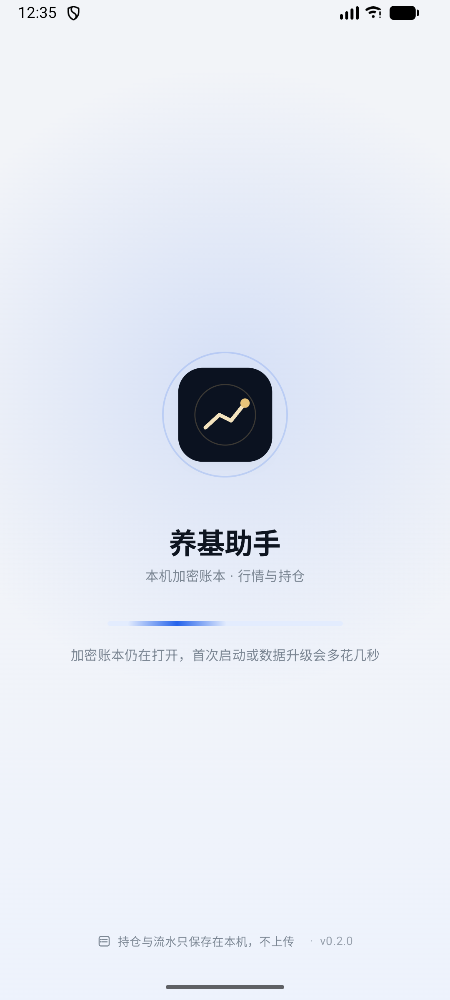

### 7.3 基金持仓不会自动使用已缓存的基金净值

这是本次实测最严重的功能缺口。

进入“自选”，基金自选明确显示：

```text
易方达蓝筹精选混合
005827 · 混合型-偏股 · 2026-10-16 · 120 个净值点
1.4162   +0.08%
```

但回到总览，同一只基金显示：

```text
市值：待更新价格
持仓盈亏：待估值
无报价
报价 0/1 · 尚无报价时间 · 部分持仓缺报价
```

“持仓”页要求用户手工填写“当前净值（元）”，然后才变成 ¥5,000.00。也就是说，App 已经在 `fund_nav_points` 中保存了 1.4162，但持仓估值不读它。

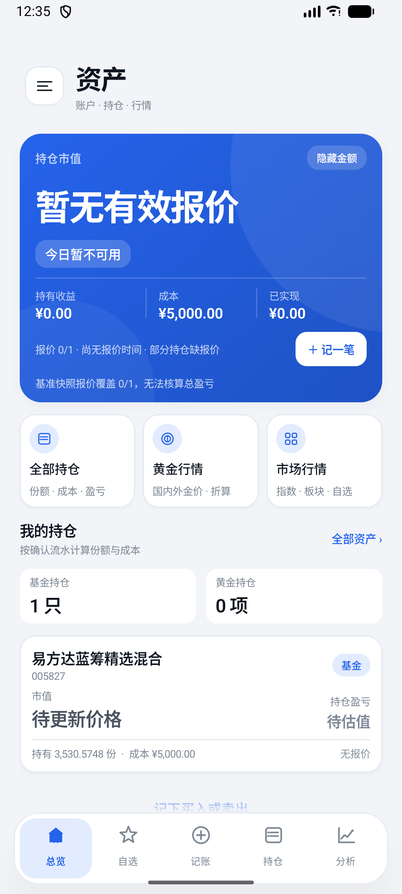

代码对应：

- `syncLinkedMarketQuotes` 只处理有 `marketQuoteSecid` 的场内行情（`PortfolioQuoteRouter.quoteFor`），005827 这类场外基金没有该路由；
- `quotes` 表只由 `setQuote`（手动）、`saveAssetQuote`（行情同步）写入；
- `fund_nav_points` 的更新链路没有把最新净值写回持仓报价。

后果：用户必须把 App 已经显示在自选页的净值再手工抄一遍；新用户会以为数据没同步。修复方向：为场外基金增加“按最近公布净值自动估值”的链路，并在无最新净值时显示净值日期，而不是要求手工输入。

### 7.4 手工补价后，当日/周/月报告仍然不可算

在“持仓”页输入 1.4162 并点“更新”后：

- 总览变为 `¥5,000.00`、`报价 1/1`；
- 但主卡仍显示 `今日暂不可用`；
- 底部仍写 `基准快照报价覆盖 0/1，无法核算总盈亏`；
- 分析页今日/本周/本月报告都显示 `暂不可算`；
- 本周/本月原因还是 `缺少周期开始前的基准快照`。

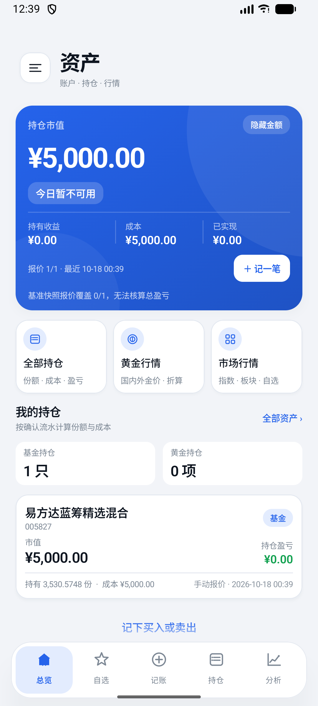

同一时刻“数据健康”却显示：

```text
持仓估值 1 / 1 项有价格
所有当前持仓都有可用估值
组合观察 3 个有效观察日
```

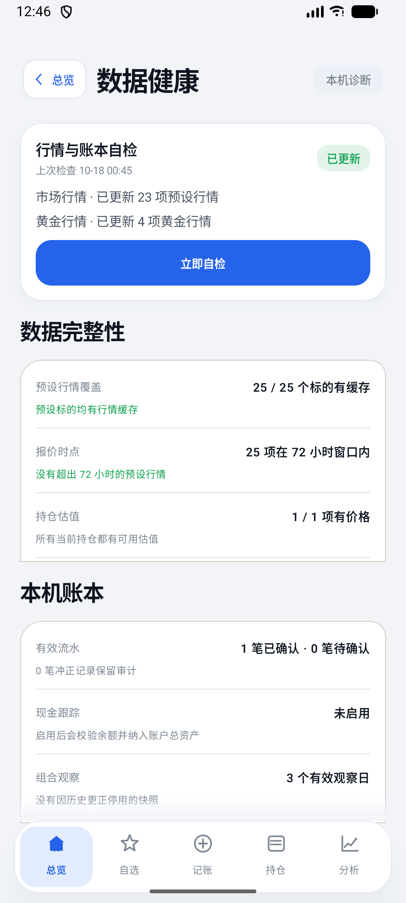

这是明确的跨页口径矛盾：

- `savePortfolioSnapshot` 只重写“今天”的快照；昨天在无报价时生成的 0/1 快照仍保持原样；
- `setQuote` 只写 `quotes`，不调用 `invalidatePortfolioFactsFrom`，也不触发历史快照重算；
- `PortfolioAnalytics.facts` 的日报同时要求 `opening.complete` 和 `closing.complete`；opening 是昨天那条 0/1，于是今日盈亏永远不可算；
- `DataHealthScreen` 只看当前 `positions.count { it.value != null }`，不看历史快照，所以显示“全部有估值”。

修复方向：补价/更正后从最早受影响日重算快照；或者日报在没有完整昨日快照时明确降级为“从今日起观察”，不要用“基准快照 0/1”把用户卡死。

另外，分析页同时出现：

```text
已记录 3 个有效观察日
2 个有效观察点
```

前者是 `snapshots.size`，后者是图表过滤掉不完整快照后的点数；同一屏两个数字不一致，用户无法判断到底有几个观察日。

### 7.5 基金盘中估算失败时没有兜底，也没有可感知的重试状态

在 005827 的基金画像里实测：

```text
盘中净值估算
无可用路由 · 暂无估算
— · 网络连接中断，请稍后重试
刷新重仓行情后重估
```

先点“刷新重仓行情后重估”，等待 8 秒，页面没有任何变化；随后在“数据健康”执行“立即自检”，市场行情 23 项、黄金 4 项均更新成功，再回到基金画像重试，仍然是同一句“网络连接中断”。

代码对应 `FundFeatureState.estimateNav` 的 T1 分支：持仓行情/复权日线任一环节抛异常时，外层 catch 直接把 `navEstimate` 替换为 `FundNavEstimator.estimate(profile, emptyList(), null)` 并覆盖 reason；它跳过了 `FundNavEstimator` 内部本应存在的“披露重仓快照兜底”。所以一次网络失败会让本来可以退化为 T2 低质量参考的基金直接变成“无可用路由”，且按钮没有 loading/失败原因区分。

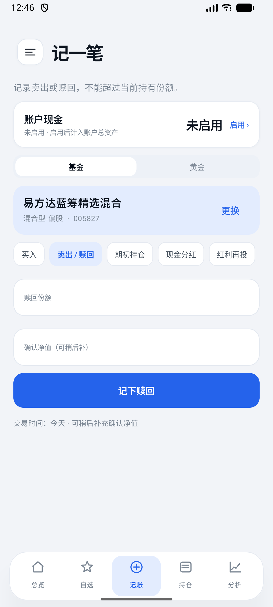

### 7.6 黄金：源时间被本机抓取时间替代，30 日变化缺少标签

黄金页第一次显示：

```text
国内现货 · AU9999
¥892.00
上金所公开现货 · 10-18 00:51
```

等待 35 秒后自动刷新，变成：

```text
上金所公开现货 · 10-18 00:52
```

2026-10-18 是周日，上金所不交易，源时间不可能每分钟前进。代码 `fetchSgeAu9999Quote` 在 `delaystr` 解析失败时用 `getOrDefault(fetchedAt)`，把本机抓取时间当成源时间；随后 `sourceTime` 再参与“新鲜度”和溢价展示。这会把周五收盘价伪装成周日实时价。

同一张卡里：

```text
国内 Au99.99 ¥892.00
国际折算 ¥897.22
-65.92 元/克
溢价 -5.22
```

`-65.92` 实际是“30 日国内价格变化”（`domesticChange = domesticSlice.last - domesticSlice.first`），但 UI 没有“30日变化”标签；它紧挨着“溢价 -5.22”，很容易被读成溢价。实际溢价是 892.00 − 897.22 = −5.22。

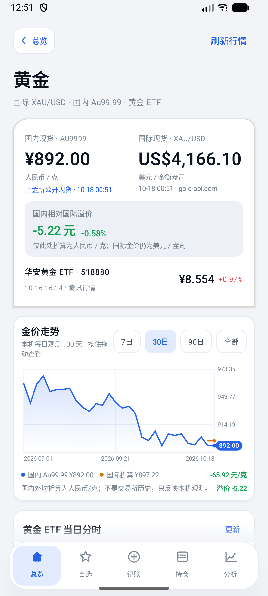

### 7.7 自选、分析、助手、提醒的体验问题

**自选：基金自选卡没有“打开详情”。** 卡片只有“刷新净值”和“移除”；点基金名/净值没有反应。要查看基金画像和盘中估算，必须去“记账 → 搜索基金”，路径绕。代码 `FundWatchlistPanel` 只暴露 `onRefresh/onRemove`，没有 `onOpen`。

**自选：基金卡初始被底部导航遮住。** 首次进入自选时，基金自选只露出上半行，需要先向上滚才能看到“刷新净值/移除”。见 `screenshots/2026-10-18/13-watchlist-fund-card-under-nav.png`。

**分析：图表吃掉了纵向滚动手势。** 在资产走势图上向上滑，页面不滚动，而是选中图表点；只有从屏幕最右侧窄边滑动才能滚动页面。`MarketSeriesChart` 的 `pointerInput` 对按下/拖动全部消费，没有区分“横向选点”和“纵向滚动”。图表占据大半屏，普通用户很容易卡在这一屏。

**助手：没有可见返回按钮。** 进入 AI 助手后，顶部只有会话历史、标题、编辑、更多，没有返回箭头；`AssistantHeader` 虽然接收 `onBack`，但没有使用。用户只能靠系统返回，和 App 其他子页统一的“‹ 总览”不一致。

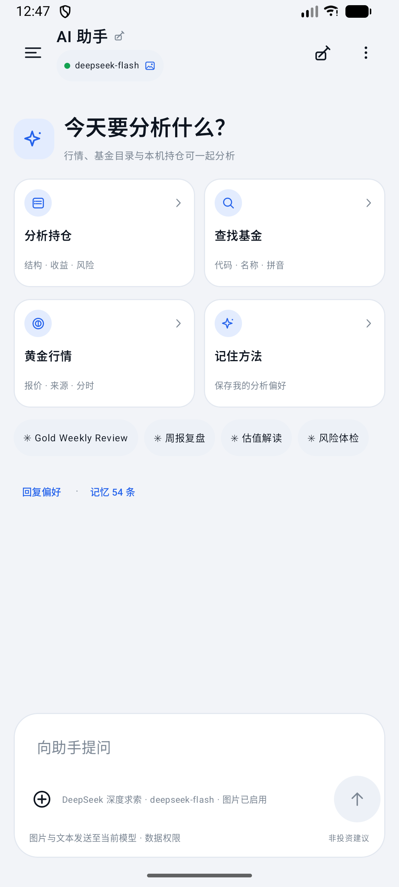

**提醒：通知权限只藏在提醒页。** 首页/抽屉没有任何提醒权限提示；用户不主动进入提醒页，就不知道通知不可用。API 37 上实测提示“尚未授予通知权限”，授权后横幅才消失；低版本还会遇到本报告 P0-2 的权限判断 bug。

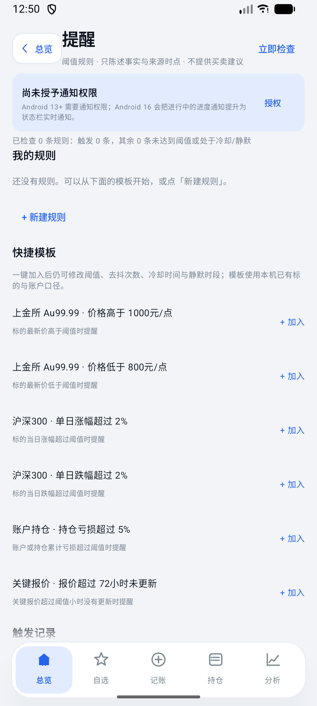

### 7.8 深色模式对比度与横屏/旋转

深色模式下，总览主卡仍是浅蓝渐变 + 白字，金额、状态胶囊和“报价 1/1”都明显发灰，对比度低于浅色主卡。深色主题的卡片/导航本身正常，但主视觉卡没有换一套深色表面。

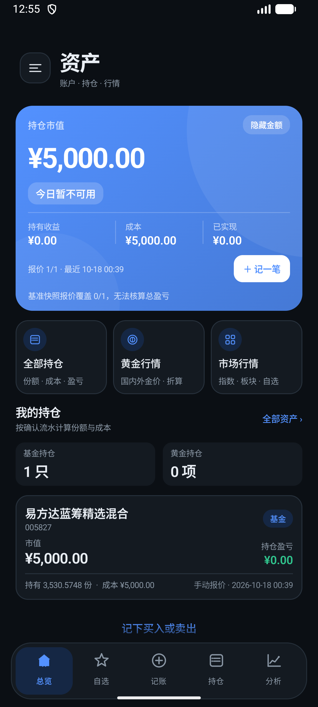

横屏：

- 主卡被拉伸到几乎全宽，底部持有收益/成本/已实现被底部导航遮住；
- 页面没有横屏布局，仍按竖屏单列排；
- 底部导航覆盖主卡下半部，首屏看不到“我的持仓”。

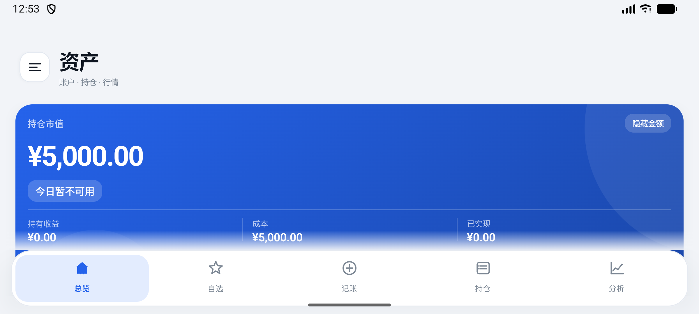

旋转还会丢失当前页面：在黄金页旋转后回到总览，而不是黄金页。原因是 `MainActivity` 的 `tab`、`selectedMarket`、`showSectors`、表单草稿全部用 `remember` 而不是 `rememberSaveable`，Activity 重建就重置。`docs/14` 的 UX-07 仍未完成。

### 7.9 更新页与文档状态

更新页实测：

```text
当前版本 v0.2.0
数据库 v25 · 加密备份 v7
更新源 JUANWANG-BUAA/kestrel-ledger
发现新版本 0.2.1
```

数据库实际是 **v26**，更新页仍写 v25；`docs/README` 的默认仓库和 README 的 195/data30/v24 表述已在本次文档修正中更新，但 `UpdateScreen` 的 v25 仍在代码里。更新页本身能发现 0.2.1 并开始下载（实测 30 秒约 5%，随后离开页面，缓存目录无文件，未完成安装/签名校验走查）。

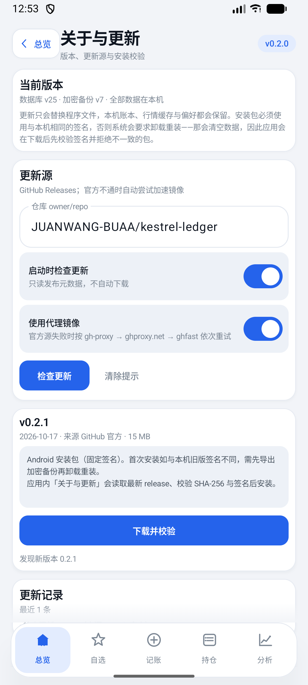

### 7.10 实测问题清单（追加待办）

| ID | 实测问题 | 级别 | 对应代码/证据 |
|---|---|---|---|
| SIM-01 | 首次约 27 秒、后续约 4 秒才出首页，Splash 无阶段进度 | P1 | 启动日志、`01-splash.png` |
| SIM-02 | 已缓存基金净值不自动用于持仓估值，要求手工抄写 | P0 | `02-home-fund-without-quote.png`、`syncLinkedMarketQuotes` 无场外基金路径 |
| SIM-03 | 补价不重算昨日快照，今日/周/月盈亏仍不可算 | P0 | `03-home-after-manual-nav.png`、`04-daily-weekly-report-missing.png`、`PortfolioAnalytics.facts` 的 `opening.complete` |
| SIM-04 | 数据健康称“全部有估值”，报告却称基准快照 0/1 | P1 | `05-health-all-priced.png`、`DataHealthScreen` 只看当前 positions |
| SIM-05 | 基金估算网络失败后无 T2 兜底、无 loading/错误区分 | P1 | `06-fund-estimate-network.png`、`FundFeatureState.estimateNav` 外层 catch |
| SIM-06 | 上金所源时间被本机抓取时间替代，周日仍显示实时 | P0 | `08-gold-source-time.png`、`MarketData.fetchSgeAu9999Quote` fallback |
| SIM-07 | “-65.92 元/克”是 30 日变化但无标签，紧邻溢价易误读 | P1 | `08-gold-source-time.png`、`GoldTrendCard.domesticChange` |
| SIM-08 | 基金自选卡没有打开详情入口 | P1 | `13-watchlist-fund-card-under-nav.png`、`FundWatchlistPanel` 只有 refresh/remove |
| SIM-09 | 分析图表吞掉纵向滚动手势 | P2 | `MarketSeriesChart` pointerInput 全消费 |
| SIM-10 | 助手子页没有可见返回按钮 | P2 | `11-assistant-no-back.png`、`AssistantHeader` 未使用 `onBack` |
| SIM-11 | 深色主卡浅蓝底白字对比度低 | P2 | `10-dark-home.png` |
| SIM-12 | 横屏主卡被裁、旋转丢页面 | P2 | `09-landscape.png`、`MainActivity` 使用 `remember` 而非 `rememberSaveable` |
| SIM-13 | 更新页数据库版本 v25 过期；README/docs/README 已修正 | P2 | `12-update-v25.png`、`UpdateScreen` |
| SIM-14 | 通知权限只在提醒页提示，首页无感知 | P2 | `07-alert-permission.png` |
| SIM-15 | 分析页“3 个有效观察日”与“2 个有效观察点”同屏不一致 | P2 | `AnalysisScreen` 的 `snapshots.size` vs 图表过滤 |

> 说明：AVD 的公开行情源部分接口在本次会话中间歇失败，SIM-05 的“网络连接中断”可能包含环境因素；但“外层 catch 跳过 T2 兜底、按钮无反馈”是代码级可确认的行为。SIM-02/03/06/07/08/10/12/13 不依赖网络，已在模拟器复现。

## 8. UI 视觉分析：为什么“不算难看，但很普通”

### 8.1 结论

这套 UI 不是“没有设计系统”。`MarketTheme` 有完整 token、明暗色板、类型阶、密度/圆角/字号设置；问题在于：

> **设计系统只做到了“统一”，没有做到“有主张”。**

它目前是一套标准的“蓝色金融仪表盘模板”：蓝紫渐变主卡、白色圆角卡片、胶囊筛选、浮动胶囊底栏。功能上清楚，视觉上没有记忆点；换成任何一家理财 App 的名字都不违和。这就是“大众化”的根源。

### 8.2 可量化的视觉证据

对 `app/src/main/java` 做了一次 token 使用统计：

| 指标 | 实测 | 含义 |
|---|---|---|
| `fontSize = ...sp` 声明 | **478 处，26 种字号** | 类型阶名义上只有 `MarketType` 的 11 种，但页面大量绕过 |
| 9sp / 10sp / 11sp | 77 / 162 / 95 处 | **70% 的字号落在 9–11sp**，其中 9–10sp 占一半 |
| 硬编码 `Color(0x…)` | **63 处，分布在 13 个页面文件** | 主题色板之外还有一套事实上的本地色板 |
| `RoundedCornerShape(...dp)` 字面量 | 15 种圆角值（8–26dp） | “圆角”设置无法覆盖所有卡片 |
| `Card(` / `MarketCard` | 54 / 9 处 | 每个区块几乎都是一张同权重白卡 |
| `muted #7C8794` on white | 对比度 **3.65:1** | 10.5sp 说明文字低于 AA 4.5:1 |
| 深色主卡白字 | 对比度 **3.23–3.58:1** | 11–15sp 白字低于 AA |
| 语义色 on white | 红 3.91 / 绿 3.37 / 琥珀 3.19 | 10–13sp 涨跌/警告文字偏弱 |

这组数字解释了两件事：

1. **字太小、太碎**：大部分界面不是“信息密度高”，而是“该大的不够大、该小的太多”。一屏里有一个 36sp 的主数字，其余大量 9–10sp 灰字，中间层缺失。
2. **颜色不统一**：主题说“旧的暖纸/琥珀身份已经移除”，但页面里仍散落着 `#D8D8D2`、`#E9E7E1`、`#F0E8DC`、`#8B78C8` 等暖灰/米色/紫色。它们和冷蓝主题混在一起，视觉上会“发脏”。

### 8.3 六个具体原因

#### 1. 语法是“模板语法”，不是“产品语法”

当前首屏的结构是：

```text
大渐变主卡（总资产 + 状态胶囊 + 三个指标 + 主按钮）
→ 三个等宽快捷卡
→ 两个统计卡
→ 一张持仓卡
→ 浮动胶囊底栏
```

这是典型的 fintech 模板：任何记账、理财、银行 App 都能套。用户记不住“养基助手”长什么样，因为没有任何只属于它的构图、字体、图形或数据表达。

更可惜的是，产品最强的差异点是**本机加密账本 / 不联网 / 数据不出设备**，但界面里几乎没有视觉表达：没有锁、没有账本、没有“本机”印章、没有私密资产的安全感。首屏最亮的地方只写了一个金额。

#### 2. 类型阶存在，但被页面绕过了

`MarketType` 定义了 heroAmount 36、amount 32、title 22、section 15、numberLarge 19、number 15、numberSmall 13、nav 14.5、body 13、label 11.5、caption 10.5。方向是对的，但页面仍大量写：

```kotlin
fontSize = 9.sp
fontSize = 10.sp
fontSize = 11.sp
fontSize = 12.sp
```

结果：

- 26 种字号并存，视觉上像“每个组件自己决定大小”；
- 9–10sp 的中文说明在 1080p 手机上偏小，灰色又低对比，读起来累；
- 主数字 32–36sp 与说明 9–10sp 之间没有 16–20sp 的过渡，显得“一个大数字 + 一堆小字”；
- 中文字体完全使用系统默认（无 `FontFamily`），和任何 Android App 一样，缺少品牌性格。

**这是“没有吸引力”的第一原因**：不是信息不够，而是字号层级没有节奏。

#### 3. 颜色只有一个强调色，且被用到了所有地方

默认电蓝 `#2563EB` 同时承担：主按钮、链接、选中态、图标、K 线、图表线、开关、底栏选中、胶囊、助手状态点。所有东西都在“强调”，结果没有东西真正被强调。

同时：

- 黄金页没有“金”的视觉语义，仍然是蓝色按钮 + 蓝色链接；
- 分析页的资产曲线是红色，黄金页是蓝色，图表没有统一的视觉语言；
- 板块页仍用米色选中底 `#F0E8DC`，与冷蓝主题冲突；
- 图表网格仍是暖灰 `#E4E2DC` / `#E9E7E1`，和白卡的冷灰边框不是一套；
- 深色模式只是把强调色 `lighten(0.18)`，主卡变成浅蓝底白字，对比度反而下降。

**颜色不是“多”，而是“没有主次”**：一个强调色 + 涨跌色 + 暖灰残渣 + 局部米色/紫色，视觉上自然不高级。

#### 4. 所有内容都是同一张白卡

`MarketCard` 统一是：白底、1dp 边框、2dp 阴影、16dp 圆角、10dp 内边距。这个规则本身没问题，问题是**所有层级都用它**：

- 主卡、快捷入口、统计、持仓、风险、基准、配置、报告、提醒、设置……都是同一张卡；
- 卡片之间没有“主/次/背景”的层级，只有内容多少的差别；
- 边框 + 阴影同时存在，边缘发软；圆角 16/17/13/12 混用，细节不一致；
- 页面变成“卡片堆”，而不是“一个有节奏的页面”。

当每个模块都被装进同样的盒子，用户的眼睛没有落脚点，就会觉得“平”“普通”。

#### 5. 没有品牌资产：字体、插画、图标、纹理、动效都没有记忆点

- 字体：系统默认，无 display face；
- 图标：通用线性图标（home/star/plus/chart/menu），没有一套属于产品的符号；
- 插画/纹理：只有主卡的装饰圆，没有账本纸纹、印章、网格、金属等材质；
- 动效：数字跳动、卡片淡入，属于“有动画”，但没有 signature motion；
- 启动页的黑底金币图标其实有辨识度，但进入 App 后就消失了，品牌没有延续；
- 产品名“养基助手”有一点轻松感，界面却是标准企业蓝，语气不一致。

#### 6. 文案是工程语言，不是用户语言

首屏和报告里大量出现：

```text
报价 1/1
基准快照报价覆盖 0/1
数据库 v25
deepseek-flash
记忆 54 条
Gold Weekly Review
```

这些词对开发者有意义，对普通用户是噪音。尤其“基准快照报价覆盖 0/1”这种句子，既解释了问题，又把用户推远。视觉的高级感不只来自颜色和圆角，也来自**文案是否像人说话**。

### 8.4 逐页观感


| 页面 | 观感 | 具体问题 |
|---|---|---|
| 总览 | 一张很响的蓝卡 + 五张很安静的白卡 | 主卡只有金额和状态，没有趋势/配置/隐私故事；快捷卡、统计卡、持仓卡权重相同；“资产/我的持仓/全部资产/全部持仓”重复表达 |
| 自选 | 标准行情列表 | 每行都是“名称 + 价格 + 涨跌”，没有 sparkline、分组、市场色带；9–10sp 的“行情 10-16 16:15”过小，来源信息弱 |
| 记账 | 标准 Material 表单 | 表单没有视觉焦点；“交易时间：今天”缩在底部，10sp 灰字，用户看不到“不能改日期”；空态只有文字 |
| 持仓 | 像设置页 | 每只持仓一张卡 + 一个输入框；没有总览头、没有分布/成本/盈亏的图形；手动补价流程把“数据已经存在”暴露成用户负担 |
| 分析 | 卡片堆 + 小字号图表 | 9sp 轴标签、红色曲线、3 vs 2 观察点；风险/基准/配置/报告全在一个长页，缺少“先看什么”的顺序 |
| 黄金 | 蓝色金融页，不是“黄金”页 | 金色没有成为视觉主角；30 日变化 `-65.92` 无标签；上金所时间伪造；图表网格仍是暖灰 |
| 板块 | 高密度表格 | 米色选中底与蓝色主题冲突；4 列小字；没有热力图/树图/宽度带，信息密度高但可读性低 |
| 助手 | 通用聊天壳 | 大面积空白；2×2 快捷卡；技术模型名直接露出；“记忆 54 条”像调试信息；没有可见返回 |
| 外观 | 设计得最完整 | 预览卡不错，但强调色横向列表被裁切；设置项没有说明“哪些组件会真正跟随圆角/密度” |
| 更新 | 长文 + 技术字段 | “数据库 v25”、GitHub 仓库字符串、长段落；缺少版本对比/更新内容的视觉结构 |


### 8.5 三个可选视觉方向

#### 方向 A：Modern Ledger（推荐）

关键词：**本机账本、纸感、印章、私密、克制**。

- 画布：暖白纸感 / 深墨黑；
- 主色：墨黑 + 朱砂/黄铜；涨跌色降饱和；
- 字体：中文标题用衬线（Source Han Serif / Noto Serif SC），数字用等宽/表格数字；正文系统无衬线；
- 结构：双细线、账本横线、页码、印章式“本机加密”标记；
- 主卡：不是渐变，而是一张“资产对账单”：总额、日变动、30 日 sparkline、配置条、隐私印章；
- 与“养基助手”的名字、离线账本、长期主义一致，辨识度最高。

#### 方向 B：Market Terminal

关键词：**深色、行情终端、等宽数字、高密度、速度**。

- 近黑底 + 琥珀/荧光绿；等宽字体；极细网格；
- 首页是 ticker tape + 持仓表 + 一条主曲线；
- 适合“每天看盘”的用户，和普通理财 App 区分明显；
- 风险：容易显得硬核、对女性/轻度用户不友好。

#### 方向 C：Quiet Banking

关键词：**象牙白、深绿/酒红、衬线、留白、私人银行**。

- 大标题、极少卡片、细线分隔、低饱和；
- 让“资产”有重量感，适合长期持有；
- 需要更强的排版功底，否则容易变成“空”。

**建议选 A**：它同时解释“本机账本”和“养基助手”，不需要复杂插画，靠字体、线条、印章和数字就能形成识别。

### 8.6 具体改造顺序

1. **先修字阶**：每屏只保留 4 个层级（display 40–44 / title 24 / body 15 / label 12）；禁止新增 9/10sp；说明文字最小 12sp；中文行高 1.4–1.5。
2. **再修颜色**：只保留一个品牌强调色 + 一个“黄金”辅助色 + 语义涨跌色；删除页面里的暖灰/米色/紫色硬编码；图表统一一套色板。
3. **再修容器**：圆角收敛到 2 种（如 8/18）；同屏最多 1 张 elevated 卡，其余用细分隔线/背景带；把“卡片堆”改成“章节 + 行”。
4. **重做主卡**：资产总额 + 日变动 + 30 日 sparkline + 配置条 + “本机加密”印章；让用户第一眼看到“这是我的资产，不是行情面板”。
5. **表格化数据**：自选/持仓用对齐的数字列 + 行内 sparkline；来源/时间放 11sp 次级行；涨跌用箭头 + 颜色，不只靠颜色。
6. **图表统一**：轴标签 11–12sp；一条主线 + 一条基准/对比线；加最高/最低/当前标注；不要默认红色曲线。
7. **导航收敛**：底栏 4–5 个一级入口，抽屉只放设置/工具；不要两个入口系统同时承担导航；底栏 10sp 标签抬到 11–12sp。
8. **文案去工程化**：把“报价 1/1”“基准快照报价覆盖 0/1”“数据库 v25”“deepseek-flash”“记忆 54 条”改成用户语言；技术细节放二级展开。
9. **深色模式重做**：主卡用深色表面 + 高对比强调色，不使用浅蓝底白字；正文/说明对比度 ≥4.5:1。
10. **横屏/状态**：补 landscape 两栏或锁定竖屏；tab/route/draft 用 `rememberSaveable`；底栏不遮内容。
11. **品牌资产**：把启动页的金币线标记延伸到标题/空态/图标；做一套 12–16 个线性图标；加入一个 signature motion（数字滚动/账本翻页）。

### 8.7 视觉审计追加待办

| ID | 事项 | 优先级 |
|---|---|---|
| UI-AUDIT-01 | 选定一个视觉方向（建议 Modern Ledger），先做 3 张关键页高保真：总览 / 持仓 / 黄金 | P0 |
| UI-AUDIT-02 | 收敛字阶到 4 级，删除 9/10sp，说明文字 ≥12sp | P0 |
| UI-AUDIT-03 | 删除硬编码暖灰/米色/紫色，统一色板与图表色 | P0 |
| UI-AUDIT-04 | 圆角收敛到 2 种，减少卡片/阴影，改为章节+分隔线 | P1 |
| UI-AUDIT-05 | 重做主卡为“资产对账单”（sparkline + 配置条 + 隐私印章） | P1 |
| UI-AUDIT-06 | 自选/持仓表格化，行内 sparkline，来源时间次级化 | P1 |
| UI-AUDIT-07 | 图表轴标签 11–12sp、加标注、统一主线/基准色 | P1 |
| UI-AUDIT-08 | 导航收敛，底栏标签 ≥11sp，去掉与抽屉的重复导航 | P1 |
| UI-AUDIT-09 | 文案去工程化，技术字段收进二级详情 | P1 |
| UI-AUDIT-10 | 深色模式专用主卡与对比度校验（≥4.5:1） | P1 |
| UI-AUDIT-11 | 横屏与旋转状态恢复 | P2 |
| UI-AUDIT-12 | 品牌图标/空态插画/签名动效 | P2 |


